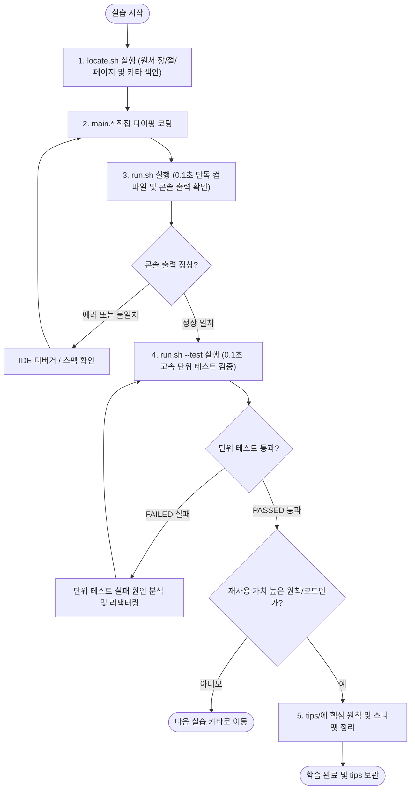

# 🚀 완벽 실습 가이드 (Operational Practice Guide)

> "교안과 목차를 펴고 ➔ 직접 타이핑하고 ➔ 쉘 스크립트로 0.1초 만에 검증하며 ➔ 버그 발생 시 디버거로 추적하고 ➔ 명품 리팩터링 및 테스트 패턴은 `tips/`에 영구 보관한다."  
> ⚡ 명령어 & 원칙 1장 요약본: [CHEATSHEET.md](CHEATSHEET.md) | 🏗️ 아키텍처 설계서: [PROJECT_STRUCTURE.md](PROJECT_STRUCTURE.md)

본 문서는 `Coding-style-refactoring-principles` 저장소를 처음 접하거나 오랜만에 열어보았을 때, "어떻게 사용하지? 어떻게 실습해야 해? 어떤 쉘을 실행하고 어떻게 디버깅하지?" 라는 질문에 대해 가장 직관적인 실습 흐름과 도구 체계를 안내합니다.

---

## 🧭 1. 전체 실습 및 검증 루프 사이클 (Closed-Loop Cycle)

501개의 모든 실습 카타는 아래의 [탐색 ➔ 타이핑 ➔ 실행 ➔ 테스트 ➔ 디버깅 ➔ 원칙 정리] 루프 사이클로 학습하고 체화합니다.



### 📋 루프 사이클 핵심 실행 명령 요약표

| 단계 | 실행 명령어 / 행동 | 판단 및 분기 (Branching) | 다음 액션 |
|:---:|:---|:---|:---|
| 1. 위치 색인 | `./scripts/locate.sh <키워드/경로>` | 원서의 몇 장 몇 절 몇 페이지인지 색인 확인 | 해당 챕터 열람 및 `main.*` 오픈 |
| 2. 타이핑 | `main.*` 직접 코딩 | 스켈레톤 가이드 보며 손으로 직접 구현 | 3단계로 이동 |
| 3. 단독 실행 | `./scripts/run.sh <경로>` | • 에러 또는 출력 불일치 ➔ IDE 디버거 실행<br/>• 콘솔 출력 정상 ➔ 4단계로 이동 | 0.1초 고속 빌드 & 콘솔 출력 확인 |
| 4. 단위 검증 | `./scripts/test.sh <경로>` | • `[ FAIL ]` 실패 ➔ 단위 테스트 단언문 대조 및 버그 수정<br/>• `[ PASS ]` 통과 ➔ 5단계로 이동 | 0.1초 Fast-path 단위 테스트 자동 검증 |
| 5. 원칙 보관 | `tips/`에 패턴/원칙 정리 | 트레이드오프나 테스트 원리가 우수한 코드인지 자가 판단 | `tips/snippets.md`에 추가 및 보관 |

---

## 🛠️ 2. 단계별 상세 수행 가이드 (Step-by-Step)

### 📖 1단계: 목차와 위치를 확인한다 (어디를 펼칠까?)
* `./scripts/locate.sh <키워드>`: 키워드로 501개 카타 중 원하는 주제를 즉시 검색합니다.
```bash
# 화폐(currency) 관련 TDD 카타 검색
./scripts/locate.sh currency

# 모의 객체(mock) 관련 단위 테스트 카타 검색
./scripts/locate.sh mock

# Book 06 (TDD) 전체 목차 트리 출력
./scripts/locate.sh --tree content06
```

### ⌨️ 2단계: 타이핑을 한다 (어디에 어떻게 칠까?)
* 항상 프로젝트 최상위 루트 터미널을 유지합니다 (하위 폴더 이동 금지).
* `tracks/` 하위 해당 폴더의 `main.*`와 `README.md`를 열어 직접 한 글자씩 타이핑합니다:
  - TypeScript: `main.ts`, `test.ts`
  - Java: `Main.java`, `Test.java`
  - Python: `main.py`, `test.py`
  - C++: `main.cpp`, `test.cpp`

### ⚡ 3단계: 단일 실행 및 단위 테스트 검증
* 단일 파일 고속 실행 (`run.sh`):
  확장자를 자동 감지하여 0.1초 만에 실행합니다.
  ```bash
  # TypeScript 카타 실행
  ./scripts/run.sh tracks/02_good_code_bad_code/01_code_quality/01_core_example

  # Java 카타 실행 (Java 25 LTS)
  ./scripts/run.sh tracks/06_tdd/01_multi_currency/01_core_example

  # C++17 카타 실행
  ./scripts/run.sh tracks/01_code_complete/01_welcome_to_construction/01_core_example
  ```

* 단위 테스트 자동 검증 (`test.sh`):
  ```bash
  # 단위 테스트 검증
  ./scripts/test.sh tracks/06_tdd/01_multi_currency/01_core_example
  ```

### 🐞 4단계: 버그 발생 시 디버깅
* 콘솔 출력이 예상과 다르거나 `[ FAIL ]`이 발생하면:
  1. `README.md`의 도서 원문 설명 및 의도 확인
  2. `test.*`의 `expect` / `assert` 단언문 조건 확인
  3. VS Code / IntelliJ / CLion 등 선호하는 IDE에서 중단점(Break Point)을 걸고 변수 상태 추적

### 🏷️ 5단계: 명품 리팩터링과 테스트 원칙은 `tips/`에 보관, 사람 검증 및 기술 블로그 발행
* 실습 코드 위에 `@snippet("설명")` 또는 `[[snippet("설명")]]` 태그를 달고 CLI로 관리합니다:
  ```bash
  # 스니펫 검증 상태 대시보드 조회 (VERIFIED / PENDING / OUTDATED)
  ./scripts/snippets.sh --status

  # 사람이 직접 검증 완료 승인 및 SHA-256 해시 고정
  ./scripts/snippets.sh --verify <스니펫ID> --reviewer "이름"

  # tips/snippets.md 문서 내보내기 및 갱신
  ./scripts/snippets.sh --export

  # tips/posts/ 에 8대 필수 얼개 규격 기술 블로그 포스트 발행
  ./scripts/snippets.sh --export-blog

  # tips/posts 포스트 메타데이터 및 환경 명세 기계적 강제 검증 (handcrafted 표준)
  ./scripts/snippets.sh --lint
  ```

---

## 🛠️ 2.5. VS Code 원클릭 빌드 & 테스트 환경 (`.vscode/tasks.json`)

에디터에서 터미널 명령어를 일일이 입력하지 않고도 단축키로 카타를 즉시 실행할 수 있습니다:
* `Cmd + Shift + B` (macOS) / `Ctrl + Shift + B` (Windows/Linux):
  - 현재 열려 있는 카타의 `main.*` 초고속 실행 (`./scripts/run.sh`)
* 테스트 태스크 실행 (`Run Test Task`):
  - 현재 열려 있는 카타의 `test.*` 단위 테스트 즉시 검증 (`./scripts/test.sh`)
* 마스터 파이프라인 동기화 태스크:
  - `Master: Run Full Sync Pipeline` 선택 시 `./scripts/sync_all.sh` 4단계 자동 검증 수행

---

## 🌐 3. 공식 다국어 런타임 표준 사양

본 저장소의 모든 카타는 추가 설치 없이 로컬 네이티브 런타임으로 즉시 빌드됩니다:

* TypeScript 7.x: `Node.js (LTS)` & `ts-node --transpile-only` (ESNext / ECMAScript 2026)
* Java 25 LTS: `/opt/homebrew/opt/openjdk/bin/javac` & `java` (OpenJDK 25/26 호환)
* Python 3.15.1 / 3.14: Python.org 공식 최신 안정화 릴리즈 (`python3`)
* C++17 / C++20: Apple Clang++ / GCC g++ (`-std=c++17 / -std=c++20`)
* GraalVM: 의존성 0% (완전 배제)
