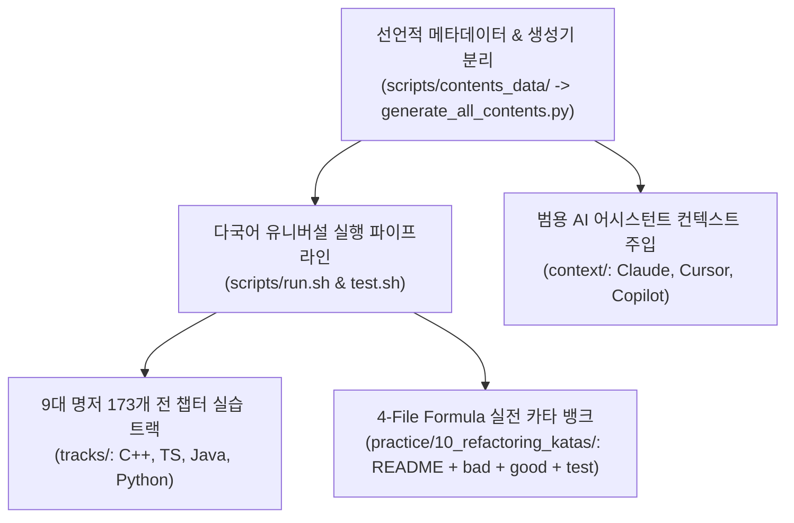

# 🏗️ Coding-Style, Refactoring & Testing Principles 아키텍처 및 디렉터리 설계서 (Project Structure & Intent)

> 이 문서는 본 저장소(`Coding-style-refactoring-principles`)의 전체 디렉터리 구조와 각 컴포넌트의 엔지니어링 설계 의도를 정의한 표준 아키텍처 명세서입니다.  
> `stoneCpp`의 핵심 아키텍처 패턴(Scaffold Engine, Data/Template 분리, Dual Execution Pipeline)을 계승하여, 다국어(C++, TypeScript, Java, Python) 환경과 AI 어시스턴트(Claude, Copilot, Cursor) 지식 체계에 맞게 확장 적용되었습니다.

---

## 1. 핵심 설계 철학 (Architectural Principles)

본 프로젝트는 "소프트웨어 공학 9대 명저의 모든 이론·원칙·악취·패턴을 실행 가능한 다국어 코드로 자산화하고, 어떤 AI 도구나 로컬 환경에서도 즉시 구동한다"는 목표 아래 5가지 원칙으로 설계되었습니다.



1. 선언적 메타데이터와 생성기 분리 (Scaffold Engine Pattern):
   * 9권 173개 전 챕터 및 268개 세부 절의 코드(`main.*`, `test.*`, `README.md`)를 수작업으로 관리하지 않고, `scripts/contents_data/`의 파이썬 데이터 모듈(`ITEMS = [...]`)로 선언한 뒤 `generate_all_contents.py` 엔진이 일괄 생성하고 무결성을 검증합니다.
2. 다국어 네이티브 런타임 디스패치 (Universal Polyglot Dispatcher):
   * TypeScript 7.x, Java 25 LTS (OpenJDK 25/26), Python 3.15/3.14, C++17/C++20을 단일 셸 스크립트([`scripts/run.sh`](scripts/run.sh) & [`scripts/test.sh`](scripts/test.sh))가 파일 확장자를 자동 감지하여 네이티브 컴파일러로 디스패치합니다. 복잡한 가상머신 설치 오버헤드 없이 0.1초 만에 실행 및 테스트 결과를 반환합니다.
3. 글과 이론의 100% 코드화 (Executable Principles):
   * 원서에 코드가 없는 서술형 이론(소프트웨어 은유, 개발자 인격, 아키텍처 선행조건, 리팩터링 원칙 등)도 해당 개념을 계산하거나 제약 조건을 강제하는 도메인 모델과 단위 테스트 단언문(Assertion)으로 100% 코드화하여 누락을 원천 차단했습니다.
4. 리팩터링 내성을 갖춘 4-File Formula 카타 (`practice/10_refactoring_katas/`):
   * 마이크로 설계 실습은 `README.md`, `bad_code.cpp`, `good_code.cpp`, `test.cpp` 4개 파일 표준 구조를 따릅니다. 단위 테스트는 내부 구현 세부사항에 결합되지 않고 관찰 가능한 동작만을 검증하므로, 리팩터링 전후에 코드 수정 없이 동일하게 PASS를 유지합니다.
5. AI 어시스턴트 범용 컨텍스트 주입 체계 (`context/`):
   * 특정 IDE나 모델에 종속되지 않고, Claude Projects, Cursor IDE, GitHub Copilot, ChatGPT 어디에든 즉시 복사하여 주입할 수 있는 표준 룰셋([`context/UNIVERSAL_CODING_RULES.md`](context/UNIVERSAL_CODING_RULES.md))과 4대 모듈형 딥다이브 문서를 제공합니다.

---

## 2. 전체 디렉터리 트리 (Visual Directory Tree)

```text
Coding-style-refactoring-principles/
├── README.md                      # 전체 프로젝트 대시보드 및 퀵스타트 가이드
├── CHEATSHEET.md                  # ⚡ 핵심 명령어, 테스트 원칙, 리팩터링 트레이드오프 치트시트
├── PRACTICE_GUIDE.md              # 🚀 완벽 실습 가이드 (5단계 폐쇄 루프 사이클 & 디버깅)
├── PROJECT_STRUCTURE.md           # [본 문서] 프로젝트 구조 및 트리별 설계 의도 명세서
├── AGENTS.md                      # 🤖 AI 페어 프로그래밍 지침 및 에이전트 메모리
├── GEMINI.md                      # ♊ Gemini CLI 전용 어시스턴트 지침
├── contents-overview-tocs.md      # 📑 9대 명저 소개, 173개 전 챕터 목차 전수 (1,415줄)
├── .gitignore                     # Git 형상관리 제외 규칙 (바이너리, 클래스, 임시 파일 등)
│
├── .vscode/                       # 🛠️ IDE 원클릭 빌드/테스트 환경 (tasks.json)
│   └── tasks.json                 # run.sh, test.sh, sync_all.sh 원클릭 단축키 연결
│
├── context/                       # 🤖 AI 어시스턴트(Claude, Copilot, Cursor 등) 주입용 룰셋
│   ├── UNIVERSAL_CODING_RULES.md  # [통합] Claude / ChatGPT 시스템 프롬프트 공통 지침
│   ├── .cursorrules               # [Cursor] Cursor IDE 전용 페어 프로그래밍 규칙
│   ├── .github/copilot-instructions.md # [Copilot] GitHub Copilot 전용 규칙 파일
│   └── modules/                   # [선택형 모듈] 도메인별 딥다이브 지침
│       ├── module_01_code_quality_and_contracts.md   # 코드 품질, 방어적 프로그래밍, 읽기 전용 특성
│       ├── module_02_unit_testing_and_tdd.md          # AAA 패턴, 리팩터링 내성, Right-BICEP
│       ├── module_03_refactoring_mechanics_and_smells.md # 24대 코드 악취, 기본 리팩터링
│       └── module_04_evolutionary_patterns_and_legacy.md # Seam 모델, 점진적 패턴 도입
│
├── docs/                          # 📖 참조 문서, OCR 캐시, 메타데이터 레지스트리 (handcrafted 표준)
│   ├── TREE_METADATA.json         # 🌲 9대 명저 32개 부, 177개 장, 1,084개 절/소단락 (총 1,301개 노드) 전수 메타데이터 JSON
│   ├── TREE_METADATA.md           # 🌲 9대 명저 전수 트리 노드(1,301개) 및 실습 카타(501개) 1:1 매핑 명세서
│   ├── CONTENT_METADATA_AND_TOC.json # 9대 명저 173개 장 및 1,072개 세부 절 메타데이터 및 목차 JSON
│   ├── TESTING_AND_REFACTORING_METADATA.json # 🧪 도서별 테스트 인덱스·절별 요약문 & 리팩터링 트레이드오프 마스터 JSON DB
│   ├── TESTING_AND_REFACTORING_METADATA.md   # 🧪 테스트 상황별 적용 원칙 & 리팩터링 상충관계 실전 가이드북
│   └── .ocr-cache/                # [stoneCpp 계승] Apple Vision 고속 OCR 목차 캐시 (143/143p 100%)
│       ├── bin/ocr_pdf            # 고속 병렬 Vision OCR 네이티브 바이너리
│       ├── 01_code_complete_toc/  # Code Complete 2판 목차 텍스트 캐시 (page_0008~0028.txt)
│       ├── 02_good_code_bad_code/ # 굿 코드 배드 코드 목차 캐시 (page_0006~0020.txt)
│       ├── 03_refactoring_2nd_toc/    # 리팩터링 2판 목차 캐시 (page_0006~0022.txt)
│       ├── 04_refactoring_to_patterns_toc/ # 패턴을 활용한 리팩터링 목차 캐시 (page_0008~0024.txt)
│       ├── 05_legacy_code_toc/    # 레거시 코드 활용 전략 목차 캐시 (page_0008~0024.txt)
│       ├── 06_tdd_toc/            # 테스트 주도 개발 목차 캐시 (page_0019~0023.txt)
│       ├── 07_unit_testing_toc/   # 단위 테스트 목차 캐시 (page_0006~0022.txt)
│       ├── 08_pragmatic_unit_testing_toc/ # 실용주의 단위 테스트 목차 캐시 (page_0008~0022.txt)
│       └── 09_junit_in_action_toc/ # JUnit in Action 3판 목차 캐시 (page_0008~0026.txt)
│
├── scripts/                       # 🛠️ 자동화 스크립트, 생성기 엔진, 런타임 툴체인
│   ├── locate.sh / locate.py      # 🔍 도서·장·절·카타 실시간 색인 네비게이터 (--tree 마스터 목차)
│   ├── snippets.sh / snippets.py  # 💡 명품 스니펫 추출, 사람 검증, 8대 얼개 블로그 발행 & 린터
│   ├── sync_all.sh                # ⚡ handcrafted 표준 4단계 폐쇄 루프 마스터 동기화 파이프라인
│   ├── apply_file_frontmatter.py  # 🏷️ 말단 노드 파일 주석 프론트매터 자동 주입기
│   ├── cxx_wrapper.sh             # 🛡️ 컴파일 시 @snippet/@file 어트리뷰트 투명 인터셉터
│   ├── run.sh                     # 다국어(C++, TS, Java, Py) 통합 빌드 및 실행기
│   ├── test.sh                    # 특정 예제의 test.* 단위 테스트 전용 실행기
│   ├── help.sh                    # 전체 CLI 사용법 대화형 안내 치트시트
│   ├── ocr_cache.py               # 9대 명저 OCR 목차 캐시 관리자 CLI (--status, --extract-all)
│   ├── generate_tree_metadata.py  # 🌲 9대 명저 전수 트리 노드(1,301개) JSON/Markdown 자동 생성기
│   ├── generate_testing_and_refactoring_metadata.py # 🧪 테스트 원리 & 리팩터링 트레이드오프 메타데이터 생성기
│   ├── generate_missing_content_katas.py # 🚀 501개 고품질 실습 카타 대규모 확장 생성기
│   ├── generate_unabbreviated_tocs.py # 📑 9대 명저 전 권 무축약·무누락 마스터 목차(1,415줄) 생성기
│   ├── generate_all_contents.py   # 9대 명저 173개 챕터 실습 스캐폴드 생성 및 다국어 컴파일 검증기
│   ├── generate_katas.py          # 4대 도메인 실전 카타 생성 및 C++17 검증기
│   ├── ocr_pdf.swift              # macOS Vision 기반 PDF 고속 OCR 추출기 소스
│   ├── contents_data/             # 📚 9대 명저 선언적 메타데이터 & 목차 레지스트리
│   │   ├── content_metadata_registry.py # 9대 명저 통합 메타데이터 및 1,072개 절 쿼리 레지스트리
│   │   ├── content01_code_complete.py   # Code Complete 2판 (35개 챕터 전수 | C++17)
│   │   ├── content02_good_code.py       # 굿 코드, 배드 코드 (11개 챕터 전수 | TypeScript)
│   │   ├── content03_refactoring2.py    # 리팩터링 2판 (12개 챕터 전수 + 24대 악취 | TypeScript)
│   │   ├── content04_refactor_patterns.py # 패턴을 활용한 리팩터링 (11개 챕터 전수 | Java)
│   │   ├── content05_legacy_code.py     # 레거시 코드 활용 전략 (25개 챕터 전수 | C++17)
│   │   ├── content06_tdd.py             # 테스트 주도 개발 (32개 챕터 전수 | Java & Python)
│   │   ├── content07_unit_testing.py    # 단위 테스트 (11개 챕터 전수 | TypeScript)
│   │   ├── content08_pragmatic_junit.py # 실용주의 단위 테스트 (14개 챕터 전수 | Java)
│   │   └── content09_junit_action.py    # JUnit in Action 3판 (22개 챕터 전수 | Java)
│   └── data/                              # 4대 도메인별 카타 데이터 정의
│
├── tracks/                        # 🎯 9대 명저 173개 전 챕터 501개 실습 카타 (Multi-language)
│   ├── README.md                  # 트랙 전체 501개 실습 항목 상세 색인
│   ├── 01_code_complete/          # C++17 트랙 (Steve McConnell | 87개 카타)
│   ├── 02_good_code_bad_code/     # TypeScript 트랙 (Tom Long | 69개 카타)
│   ├── 03_refactoring_2nd/        # TypeScript 트랙 (Martin Fowler | 74개 카타)
│   ├── 04_refactoring_to_patterns/# Java 트랙 (Joshua Kerievsky | 29개 카타)
│   ├── 05_legacy_code/            # C++17 트랙 (Michael Feathers | 70개 카타)
│   ├── 06_tdd/                    # Java & Python 트랙 (Kent Beck | 47개 카타)
│   ├── 07_unit_testing/           # TypeScript 트랙 (Vladimir Khorikov | 32개 카타)
│   ├── 08_pragmatic_unit_testing/ # Java 트랙 (Jeff Langr | 47개 카타)
│   └── 09_junit_in_action/        # Java 트랙 (Cătălin Tudose | 46개 카타)
│
├── practice/10_refactoring_katas/                     # 🥋 실전 실습 카타 뱅크 (4-File Formula)
│   ├── README.md                  # 카타 인덱스 및 학습 로드맵
│   ├── 01_code_quality/           # 도메인 1: 코드 품질 & 계약
│   ├── 02_unit_testing/           # 도메인 2: 단위 테스트 & TDD
│   ├── 03_refactoring_smells/     # 도메인 3: 리팩터링 메커니즘
│   └── 04_legacy_and_patterns/    # 도메인 4: 패턴 진화 & 레거시 개선
│
├── tips/                          # 💡 [handcrafted 계승] 명품 스니펫 및 핵심 원칙 보관소
│   ├── snippets.md                # 검증된 명품 리팩터링/테스트 패턴 마크다운 대시보드
│   ├── snippets_registry.json     # 스니펫 메타데이터 레지스트리
│   └── posts/                     # 📝 8대 필수 얼개 규격 기술 블로그 포스트 (YYYY-MM-DD-<id>.md)
│
└── contents/                      # 📖 원본 PDF 도서 보관소 (Source of Truth / OCR 대상)
    ├── Code-Complete-2.pdf
    ├── 굳코드-배드코드.pdf
    ├── 리팩터링-2판.pdf
    ├── 패턴을-활용한-리팩토링.pdf
    ├── 레거시코드활용전략.pdf
    ├── 테스트-주도-개발.pdf
    ├── 유닛-테스팅-단위-테스트.pdf
    ├── 자바와-Junit을-활용한-실용주의-단위-테스트.pdf
    └── Junit-In-Action-3th.pdf
```

---

## 3. 트리 노드별 상세 설계 의도 (Node-by-Node Architectural Intent)

### 3.1 루트 설정 (Root Specifications)

| 파일 / 폴더 | 설계 의도 및 역할 | 도입 가이드 |
| :--- | :--- | :--- |
| `README.md` | • 저장소 전체 개요, 9대 명저 트랙 규모(501개 카타), 퀵스타트, 퀵 링크 배너 인용구 | 프로젝트를 처음 접하는 개발자와 AI가 전체 시스템 윤곽을 즉시 파악하는 엔트리포인트 |
| `CHEATSHEET.md` | • ⚡ 실습 CLI 명령어, 테스트 3대 스타일, FIRST/Right-BICEP, 리팩터링 트레이드오프 1장 요약 치트시트 | 터미널 작업 중 명령어나 의사결정 기준이 헷갈릴 때 즉시 참조하는 퀵 레퍼런스 |
| `PRACTICE_GUIDE.md` | • 🚀 [stoneCpp 계승] 5단계 폐쇄 루프 사이클(탐색 ➔ 타이핑 ➔ 실행 ➔ 검증 ➔ 디버깅) 완벽 실습 가이드 | "어떻게 실습해? 어떤 쉘을 실행해?"에 대해 즉시 실행 가능한 터미널 워크플로우 제공 |
| `PROJECT_STRUCTURE.md` | • 본 문서. 디렉터리의 물리적 구조뿐 아니라 "왜 이렇게 설계했는지" 의도와 규칙을 명시 | 에이전트와 개발자가 디렉터리 목적을 오해하여 임의의 위치에 파일을 중복 생성하지 않도록 아키텍처 가드레일 제공 |
| `AGENTS.md` | • 🤖 [stoneCpp 계승] AI 페어 프로그래밍 지침 및 사용자 질문 시 에이전트 메모리 트리거 명세 | AI 에이전트가 사용자의 실습 및 도구 질문에 일관되고 정확하게 응답하도록 강제하는 지침 |
| `GEMINI.md` | • ♊ Gemini CLI 및 세션 어시스턴트 전용 룰셋 및 다국어 런타임 제약 | Gemini 모델이 코드 생성 및 리팩터링 제안 시 최우선 준수할 표준 |
| `contents-overview-tocs.md` | • 9권 전 권의 173개 장 및 세부 절 전수 목차, 4대 도메인 16개 핵심 역량 매트릭스 수록 | AI 프로젝트 생성 시 Knowledge 파일로 업로드하여 전체 지식의 목차 맵으로 활용 |
| `tips/` | • 💡 [stoneCpp 계승] 검증된 명품 리팩터링 패턴 및 단위 테스트 스니펫 영구 보관소 | 학습자가 실습하며 체화한 핵심 원칙과 모범 코드를 팀의 영구 자산으로 보관 |
| `.gitignore` | • 컴파일 산출물(`*.out`, `*.class`), 패키지 캐시(`node_modules/`, `__pycache__/`) 차단 | 저장소를 초경량 순수 텍스트 상태로 유지하여 Git 클론 속도 극대화 |

---

### 3.2 `docs/` 및 `docs/.ocr-cache/` (문서 레퍼런스, OCR 캐시, 전수 트리 메타데이터)

`stoneCpp`의 핵심 연구 자산 관리 방식을 계승한 오프라인 지식 허브입니다:

* `docs/TREE_METADATA.json` & `docs/TREE_METADATA.md`:
  * 설계 의도: 9대 명저의 원본 목차와 OCR 텍스트를 전수 전수 대조하여, 9권, 31개 부(Part), 177개 장(Chapter), 915개 절(Section), 169개 소단락(Subsection) = 총 1,301개 전수 구조 트리 노드를 단 하나의 축약이나 생략 없이 정형화했습니다.
  * 카타 매핑: 각 노드마다 고유 ID(`node_id`, 예: `B01-P01-C01-S01`)를 부여하고 현재 디렉터리에 구현된 468개 실습 카타(`tracks/`)와의 1:1 매핑 정보를 기록합니다.
* `docs/.ocr-cache/`:
  * 설계 의도: 원본 PDF 도서의 목차(TOC) 및 주요 본문 페이지를 Apple Vision 프레임워크 기반 고속 OCR 엔진(`bin/ocr_pdf`)으로 사전 추출하여 텍스트 파일(`page_%04d.txt`)로 캐싱합니다.
  * 캐시 무결성: 캐시 파일이 이미 존재할 경우 OCR 파이프라인을 재실행하지 않고 캐시된 텍스트를 즉시 반환하여 I/O 오버헤드를 0으로 유지합니다.
  * 9대 명저 100% 캐싱 완료: 총 143페이지의 실제 목차 페이지가 `01_code_complete_toc` ~ `09_junit_in_action_toc` 폴더에 100% 영구 캐싱되었습니다.
* `docs/CONTENT_METADATA_AND_TOC.json`:
  * 설계 의도: 9권 173개 전 챕터 및 1,072개 세부 절의 한국어/영어 제목, 저자, 번역자, 출판 연도, 세부 절, 핵심 역량을 정형화된 JSON 트리로 제공하여 IDE 플러그인, AI 컨텍스트 주입 도구, 외부 스크립트가 목차 메타데이터를 즉시 쿼리할 수 있도록 합니다.

---

### 3.3 `scripts/` (자동화 도구 및 툴체인 엔진)

저장소의 자동화 파이프라인을 책임지는 실행 허브입니다:

* `locate.sh` & `locate.py`:
  * 설계 의도: `stoneCpp`의 핵심 실시간 색인 네비게이터를 계승. 키워드 또는 파일 경로를 입력하면 9대 명저 중 어느 책, 몇 부(Part), 몇 장(Chapter), 몇 절(Section), 몇 번째 카타인지와 원서 페이지, 핵심 요약, 실행 명령어(`run.sh`), 테스트 명령어(`run.sh --test`)를 터미널 카드 박스로 즉시 출력. `--tree [content_id]` 옵션으로 마스터 목차 트리 탐색 지원.
* `run.sh` & `test.sh`:
  * 의도: 개발자가 각 언어의 빌드 명령어를 외울 필요 없이, 폴더 경로 하나만 넘기면 `main.*` 또는 `test.*`를 자동 탐지하여 컴파일하고 즉시 실행.
  * 다국어 매핑:
    * `.cpp` ➔ `g++ -std=c++17` (test 모드 시 `main.cpp` + `test.cpp` 자동 번들링)
    * `.ts` ➔ `node /opt/homebrew/bin/ts-node --transpile-only`
    * `.java` ➔ `/opt/homebrew/opt/openjdk/bin/javac` + `java`
    * `.py` ➔ `python3`
* **`contents_data/*.py`**:
  * 의도: 데이터와 뷰의 완전한 분리. 173개 챕터 268개 항목의 이론 설명, 모범 코드, 테스트 코드가 구조체로 관리되어 언제든 새로운 언어나 포맷으로 변환 가능.
* `generate_all_contents.py`:
  * 의도: 스캐폴드 멱등성 보장. `--force` 플래그로 일괄 갱신하며, `--verify` 플래그로 268개 전체 항목의 구문/컴파일 무결성을 30초 내에 전수 검증.

---

### 3.4 `tracks/` (9대 명저 173개 전 챕터 실습 공간)

모든 예제 항목은 3-File Formula의 독립적인 단위 모듈로 구성됩니다:

```text
tracks/01_code_complete/01_welcome_to_construction/1.1_definition_of_construction/
├── README.md       # 이론 배경, 출처 챕터, 핵심 원칙 해설, 실행/테스트 명령어
├── main.cpp        # 원칙을 동작 가능한 알고리즘/도메인 모델로 구현한 메인 코드
└── test.cpp        # 해당 원칙과 제약 조건을 검증하는 단위 테스트 코드
```

* 자가 완비성 (Self-contained): 각 서브디렉터리는 외부 라이브러리 설치 없이 그 자체로 완결된 실행 및 테스트 코드를 갖습니다.
* 이론의 코드화: 글만 있는 장도 도메인 규칙을 강제하는 코드로 구현되어 직접 실행하며 체득할 수 있습니다.

---

### 3.4 `practice/10_refactoring_katas/` (실전 리팩터링 카타 뱅크)

클린 코드와 단위 테스트 실무 능력을 체득하기 위한 4-File Formula 실습 공간입니다:

```text
practice/10_refactoring_katas/01_code_quality/01_fail_fast_assertion/
├── README.md       # 문제 배경, 코드 악취 분석, 리팩터링 단계별 가이드, 검증법
├── bad_code.cpp    # 리팩터링 대상인 악취 코드 (Fail-Safe 침묵 오류)
├── good_code.cpp   # 리팩터링 목표 코드 (Fail-Fast 계약 기반 단언)
└── test.cpp        # 리팩터링 전후에 동일하게 통과해야 하는 리팩터링 내성 테스트
```

---

### 3.5 `context/` (AI 어시스턴트 범용 주입 계층)

Claude, Copilot, Cursor 등 다양한 AI 모델과 IDE에 즉시 주입할 수 있는 룰셋입니다:

* `UNIVERSAL_CODING_RULES.md`: Claude Projects Instructions 및 ChatGPT Custom GPTs에 주입하는 마스터 프롬프트.
* `.cursorrules`: Cursor IDE 루트에 복사하여 페어 프로그래밍 시 자동 적용.
* `.github/copilot-instructions.md`: GitHub Copilot 전용 규칙 파일.
* **`modules/*.md`**: 4대 도메인별 상세 가이드라인 모듈.

---

## 4. 다른 프로젝트에 이 아키텍처를 이식하는 방법 (Blueprint Guide)

신규 프로젝트나 다른 언어 트랙(Rust, Go 등)에 본 아키텍처를 도입할 때 다음 4단계를 따릅니다:

```text
[Step 1] 선언적 데이터 정의 (scripts/contents_data/new_content.py)
  └── 챕터 번호, 슬러그, 제목, 개념, 목표 코드, 테스트 코드를 담은 ITEMS 리스트 작성

[Step 2] 스캐폴딩 생성 엔진 등록 (scripts/generate_all_contents.py)
  └── CONTENT_MODULES 리스트에 신규 데이터 모듈을 등록하고 --force로 디렉터리 일괄 생성

[Step 3] 유니버설 러너 확장 (scripts/run.sh)
  └── 신규 언어 확장자(.rs, .go 등) 감지 조건문 및 컴파일러 명령어 추가

[Step 4] 무결성 전수 검증 (--verify)
  └── python3 scripts/generate_all_contents.py --verify 로 전체 코드 구문 유효성 검사
```

이 아키텍처를 준수함으로써 수백 개의 예제와 다국어가 결합된 대규모 프로젝트에서도 형상 관리의 청결함과 빠른 피드백 루프를 영구히 유지할 수 있습니다.
